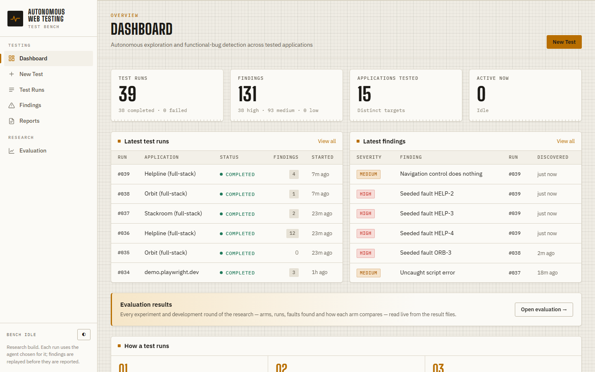
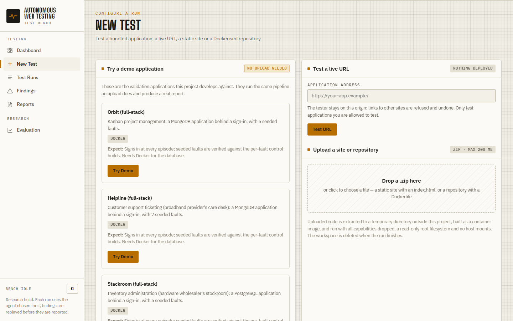
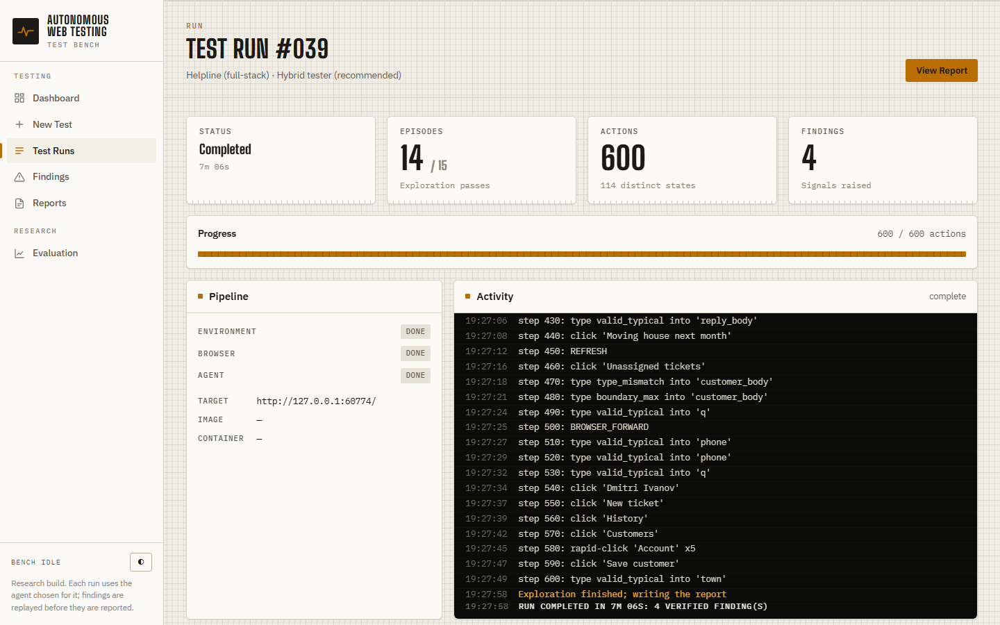
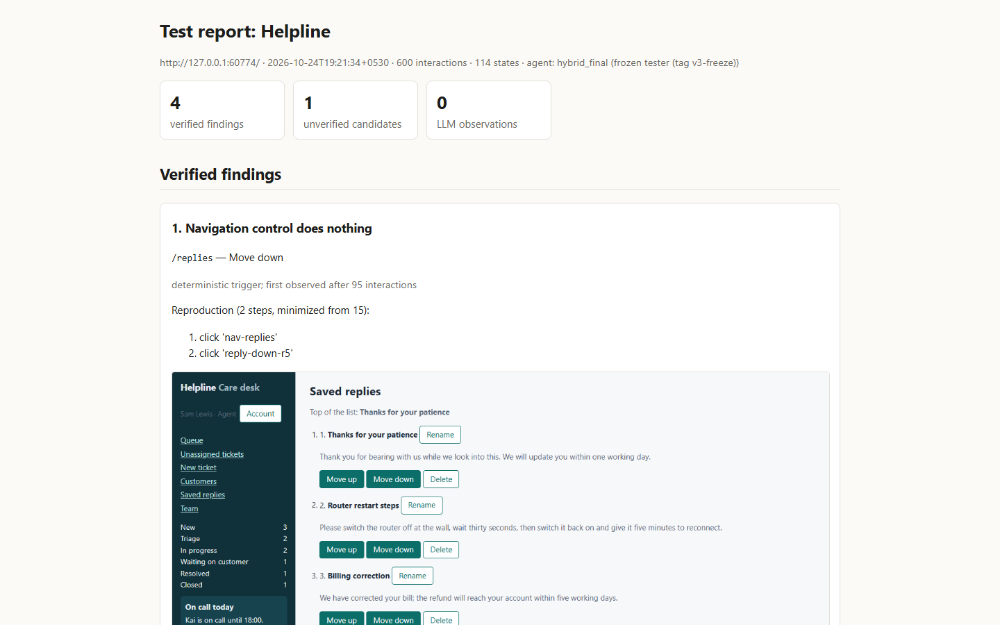
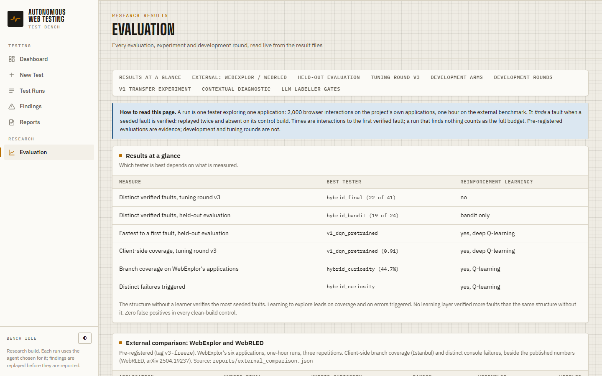

# RL-based Automated Web Testing Agent

An automated **functional** tester for web applications that uses reinforcement learning.
It drives a real browser (Playwright) through a live application and explores it, looking
for faults. A fault counts only when it is **verified** by deterministic means: it must
replay twice in fresh sessions, be absent from that fault's control build, and survive
delta-debugging minimisation. A product layer turns a URL, a static site, a Dockerfile
repository or a bundled test application into a test run with evidence and a report, from
the command line or a web UI.

Final-year B.Tech project. Security testing is out of scope.

> **Status (2026-10-24): all evaluations complete.**
> - **Finished work:** v1 (deep RL, two pre-registered experiments), the v2 hybrid tester's
>   held-out evaluation, tuning round v3 on the rebuilt full-stack apps (frozen as
>   `hybrid_final`, tag `v3-freeze`), and the pre-registered comparison with WebExplor and
>   WebRLED on their own applications.
> - **External result:** below their published numbers.
> - **Diagnosis:** a post-hoc follow-up (tag `v4-clickables`) traced much of that gap to the
>   tester's action space.
> - **Thesis:** in `thesis/` (Amrita template, 64 pages).
>
> `PROJECT_CONTEXT.md` §0 is the authoritative project state.

---

## What counts as a functional bug

A **functional bug** is a defect whose failure is an observable deviation of the
application's behaviour from its functional requirements. It must be all three of:
- **triggered** by a finite sequence of user interactions from a defined starting state;
- **observable** in what the user sees or what the application keeps: page content, the
  page reached, data shown later or persisted, or an error the browser reports;
- **wrong** against what the application's own contract says it must compute, accept,
  refuse, store or show.

This is a failure of *functional correctness* in ISO/IEC 25010 terms. Security,
performance, layout, usability and accessibility problems are out of scope.

| Class | What goes wrong | Example |
|---|---|---|
| Calculation error | a number shown differs from the correct computation over the inputs | basket total ignores a changed quantity |
| Constraint bypass | input that must be refused is accepted, or a guarded state is reached without its precondition | order placed with an empty address |
| State corruption | data shown later differs from what was entered or should be derived | express delivery chosen, confirmation says standard |
| Persistence failure | saved data is lost, reverted or not stored | an edited record reverts after reload |
| Broken transition | an action leads to the wrong page or state, or none | "Next" returns to step 1 |
| Crash-type | an interaction makes the app's own code throw, or a request to it fail | ticking a checklist item throws a script error |

The first five are *silent*: nothing errors, and the result is simply wrong. That is why
this project verifies bugs against a specification of each seeded fault. Console errors,
which published RL web testers count, catch only the last class.

## How it works

```
 application (URL / static site / Dockerfile repo / suite app with clean, faulty and control builds)
        │
 Playwright environment ── fresh browser context per episode; sign-in macro for apps behind login
        │                   action registry: clicks, typed value categories, selects, toggles,
        │                   ARIA/onclick "custom clickables" (optional)
        ▼
 page abstraction ("cell") ── page kind, path template, heading, form fill, alert, submit offered
        ▼
 archive of cells (Go-Explore) ── choose by novelty / untried options / depth, return by exact replay
        ▼
 test operator from standard test design ── complete the step, each dropdown option, invalid
        │                                    input, edit after review, back/reload and resume,
        │                                    double submit, collection churn, browse a list
        ▼
 decision layer (the learning part) ── Thompson-sampling bandit over operators, or count-based
        │                               curiosity Q-learning over page transitions, or none
        ▼
 oracle ── seeded faults: replay ×2, per-fault control build, ddmin → evidence + report
           crash faults: console / page / failed-request errors attributed the same way
           specification-free invariants (reload stability etc.): reported separately
```

The v1 learner it grew out of is still runnable as an arm. It is an action-conditioned
dueling Double DQN, Q(s, φ(a)), with prioritised 3-step replay, a residual adaptation head,
search-guided ε-exploration and an optional LLM progress reward (`qwen2.5:7b-instruct`).

## The product

A web application that tests other web applications. Point it at an application and pick an
agent. It explores in a real browser, verifies what it finds, and writes a report with a
minimal reproduction and evidence for every verified finding.



**1. Choose what to test** (*New Test*):
- **A one-click demo.** The full-stack apps (Orbit, Helpline, Stackroom) start their own
  database and sign in automatically. The benchmark and static demo sites need nothing.
- **A live URL.** The tester stays on that site's origin.
- **An upload.** A static site, or a repository with a Dockerfile. It is built and run in a
  locked-down container: no capabilities, read-only root, internal network only.

**2. Choose an agent:**
- **Hybrid tester (recommended)**: verifies the most bugs.
- **The RL agents**: hybrid + curiosity Q-learning, hybrid + Thompson-sampling bandit, and
  the pretrained deep Q-network.
- **Random**, for comparison.

Then set the interaction budget. Whether to use the local language model is optional.



**3. Watch it run.** A live event stream shows every action, the pipeline stages and
findings as they are verified.



**4. Read or download the report** (HTML, Markdown or JSON). It has three parts:
- **Verified findings:** each reproduced twice in fresh browser sessions and minimised to the
  shortest reproducing steps, with a screenshot.
- **Unverified candidates.**
- **The language model's observations**, marked unverified.

For applications that ship a fault specification, seeded faults are also checked against
per-fault control builds, so a finding is attributed to the fault that causes it.



**5. Research results** (*Evaluation*): every evaluation and experiment, read live from the
result files. It opens with the best tester per measure, then the comparison with WebExplor
and WebRLED, the held-out evaluation and the tuning rounds.



**What a typical run takes:**
- **Time:** a 400–600 interaction run takes about 5 minutes on a laptop.
- **Verification limits:** at most 10 candidates, within 10 minutes. The rest are reported
  as unverified candidates.
- **Applications behind a sign-in:** the tester signs in at the start of every episode and
  does not press sign-out.
- **Framework-built pages:** elements made clickable by JavaScript (ARIA roles, click
  handlers) are included, so React and Vue pages are explored.

## Agents (arms)

| Agent | Learning | Where it stands |
|---|---|---|
| `hybrid_final` | none: hybrid + `browse_list` + failure feedback (frozen, `v3-freeze`) | most distinct verified faults in tuning (22/41); external: 44.3% branch coverage |
| `hybrid_curiosity` | hybrid + count-based curiosity Q-learning (RL) | best of ours on WebExplor's apps: 44.7% coverage (54.1% with clickables), most failures triggered |
| `v1_dqn_pretrained` | AC-DQN pretrained on the 6 benchmark apps, adapting online (deep RL) | held-out: 34/40 runs, lowest mean time to first fault; highest coverage in tuning |
| `hybrid_bandit` | hybrid + Thompson-sampling operator bandit | held-out: 34/40 runs, most distinct faults (19/24); slower than no learner in tuning |
| `hybrid_nolearn` | hybrid, untried operators in turn, no learner | held-out primary arm: 30/40 runs, 18/24 faults |
| `random` | uniform over valid actions | the baseline |

**Which arm is best depends on the measure.** The structure without a learner verifies the
most seeded faults. The RL arms do best on the literature's measures: coverage (v1 AC-DQN in
tuning, curiosity on WebExplor's apps) and errors triggered (curiosity). No learning layer
verified more faults than the same structure without it. The web UI offers the RL agents and
random. Development-only arms (`dev_*`) and the post-hoc `*_clickables` arms are defined in
`src/web_testing_agent/hybrid/run.py`.

## Results so far

| # | Question | Result | Status |
|---|---|---|---|
| 1 | Does pretraining an RL tester on other apps help on a new app? (v1, 6 apps, 210 runs) | No measurable benefit: pretrained − scratch median Δ 0 [−749, +290], p = 0.53 (too wide to rule a benefit in or out) | pre-registered, frozen |
| 2 | Does the v1 network learn which action helps in which state? (228 jobs) | Not supported: within-label AUROC 0.51 (rule ≥ 0.70) | pre-registered, frozen |
| 3 | Does the LLM progress reward point at faults? | Only on the apps it was tuned on (AUROC 1.00 vs 0.38–0.73) | post-hoc |
| 4 | Can a local LLM label pages and controls reliably? | No: gates failed (0.68/0.78; 0.61/0.75 on fresh pages) | gated in advance |
| 5 | Does a learner help on top of the hybrid tester? (development, 5 rounds, 7 variants) | Not distinguishable from no learner | development |
| 6 | Does curiosity-driven RL (WebExplor/WebRLED components) find functional faults? | At random level (17/42 vs 18/42) | development |
| 7 | **Held-out** (8 unseen apps, 160 runs + 32 clean controls): hybrid vs random, vs v1 AC-DQN, bandit vs none | **All four comparisons inconclusive.** Hybrid arms verified the most distinct faults (19, 18 of 24 vs random 13), including 9 no random run found; 0 false positives | pre-registered (tag `v2-eval-freeze`), frozen |
| 8 | Tuning round v3 on the rebuilt full-stack suite (192 + 24 runs) | `browse_list` + failure feedback best (22/41 distinct faults); bandit slower than no learner; frozen as `hybrid_final` | development |
| 9 | **External:** WebExplor's 6 apps, measured as published (1 h runs, Istanbul branch coverage, console failures) | **Below the published numbers:** 44.3% coverage vs WebExplor 55.5% / WebRLED 64.2%; 1.8 vs 3.1 / 4.1 failures. Comparable on Pagekit and Splittypie | pre-registered (tag `v3-freeze`) |
| 10 | Is the gap the action space? (all arms + custom clickables, 81 runs) | Phoenix 49% → 82–83% for every arm (WebRLED 82.9%); excluding Petclinic, ~50–53% vs WebExplor 49.6% / WebRLED 60.0%; Retroboard unchanged | post-hoc (tag `v4-clickables`) |
| 11 | **External, round 2:** listener-based clickables, 5 runs per app (as the papers), same hardware (60 runs) | `hybrid_curiosity_v5` 53.6% (55.1% without Petclinic), `hybrid_final_v5` 51.5%, vs WebExplor 55.5% (49.6%) / WebRLED 64.2% (60.0%). Above both papers on Pagekit, Splittypie and Phoenix; below on Dimeshift, Retroboard and Petclinic. Console failures 1.9–2.3 vs 3.1 / 4.1. `hybrid_final` +9.7 points over round 1 on the same hardware, up on all six apps | pre-registered (tag `v5-freeze`), informed by round 1 |

Held-out per arm:

| Arm | Runs that found a fault | Restricted mean time | Distinct faults (of 24) | Clean-build false positives |
|---|---|---|---|---|
| `v1_dqn_pretrained` | 34/40 | **595** | 17 | 0/8 |
| `hybrid_nolearn` | 30/40 | 737 | 18 | 0/8 |
| `hybrid_bandit` | 34/40 | 769 | **19** | 0/8 |
| `random` | 32/40 | 978 | 13 | 0/8 |

External comparison per application (branch coverage %). Round 1: mean of 3 one-hour runs.
Round 2 (v5, listener-based clickables): mean of 5.

| App | `hybrid_final` | `hybrid_curiosity` | `random` | `hybrid_final_v5` | `hybrid_curiosity_v5` | WebExplor | WebRLED |
|---|---|---|---|---|---|---|---|
| Dimeshift | 49.2 | 47.8 | 45.0 | 48.6 | 48.9 | 54.2 | 55.4 |
| Pagekit | 32.4 | 33.9 | 34.2 | 35.0 | **41.0** | 25.8 | 39.8 |
| Splittypie | 35.7 | 42.9 | 37.5 | 37.7 | **47.0** | 36.2 | 44.6 |
| Phoenix | 48.7 (82.0 with clickables) | 48.7 (83.3) | 46.9 (74.6) | 82.4 | **84.7** | 71.8 | 82.9 |
| Retroboard | 53.2 | 53.2 | 53.2 | 54.0 | 54.0 | 60.2 | 77.4 |
| Petclinic (20 branches, noisy) | 46.7 | 41.7 | 25.0 | 51.0 | 46.0 | 85.0 | 85.0 |
| **Average** | 44.3 | 44.7 | 40.3 | 51.5 | 53.6 | 55.5 | 64.2 |

WebExplor and WebRLED are both RL testers: tabular curiosity Q-learning, and deep Q-learning
with a learned actionable-element discriminator. The like-for-like RL comparison is
`hybrid_curiosity`. Failure counts use a post-hoc count close to the papers' manual one.
The pre-registered count also includes third-party requests and is not comparable.

The result files are `reports/transfer_final.json`, `reports/contextual_diagnostic.json`,
`reports/v2_evaluation.json`, `reports/external_comparison.json` and `runs/*/results/`. The web UI's **Evaluation** page shows
every arm and round live from these files.

## Test applications

| Set | Apps | Role |
|---|---|---|
| Benchmark (`tests/fixtures/benchmark/`) | 6 small apps, 12 seeded faults | v1 experiments; development for v2 |
| Development suite (`e2e_suite/apps/`) | tidewater, clinicflow, stackroom, ledgerly (PostgreSQL); bagstreet, helpline, orbit, wayfarer (MongoDB) | tuning. Full stack with sign-in (clinicflow, helpline, wayfarer, ledgerly and bagstreet enlarged to ≥ 12 views and ≥ 3 CRUD entities); 41 seeded faults, 8 of them crash-type (orbit, helpline, stackroom, wayfarer; all admitted incl. Docker) |
| Validation suite (`validation_suite/apps/`) | dutyday, fosterly, larder, markbook, quizcraft, sideline, skylark, tally | held-out evaluation (frozen as evaluated); 24 faults |
| External | Dimeshift, Pagekit, Splittypie, Phoenix, Retroboard, Petclinic (DIG Docker images, Istanbul-instrumented; `configs/external_apps.json`) | the comparison with WebExplor / WebRLED's published numbers |

Every suite app has a clean build, a build with all faults, and one control build per fault.
Each must pass mechanical admission (witness, control, replay, minimisation, benign traces,
a clean random walk, database contract, Docker build) before any agent runs on it. The
database drivers are vendored (`e2e_suite/vendor/`), so builds need no network.

## Quick start

Requirements: Python 3.11 and Playwright Chromium. Node.js 22 is needed for the Node suite
apps, and PostgreSQL and MongoDB (or Docker) for the development suite. Ollama with
`qwen2.5:7b-instruct` is optional, only for the LLM components. Docker is optional, for
repository uploads and container checks.

```bash
python -m venv venv
./venv/Scripts/python.exe -m pip install -r requirements.txt
./venv/Scripts/python.exe -m pip install -e .
./venv/Scripts/python.exe -m playwright install chromium
ollama pull qwen2.5:7b-instruct            # optional
./venv/Scripts/python.exe -m pytest tests -q   # ~1,300 tests; browser/Docker/torch tests skip when unavailable
```

### Web UI

```bash
./venv/Scripts/python.exe -m web_testing_agent.app      # http://127.0.0.1:8000
```

New Test → a demo app, a live URL, or an upload (a static site, or a Dockerfile repository
while Docker is running). Pick an agent, watch the live event stream, then open or download
the report (HTML, Markdown, JSON). Evaluation shows the research results. It binds to
localhost because it builds and runs uploaded code.

### Command-line tester

```bash
./venv/Scripts/python.exe scripts/test_app.py --url https://example.org/
./venv/Scripts/python.exe scripts/test_app.py --site "demo app/www"
./venv/Scripts/python.exe scripts/test_app.py --repo path/to/repo
./venv/Scripts/python.exe scripts/test_app.py --benchmark booking_desk
```

Options: `--budget N`, `--agent`, `--no-llm`, `--login-steps FILE`, `--seed N`, `--out DIR`.

### Hybrid tester runs (development and evaluation)

```bash
# Hunts: any benchmark or suite apps by name, several arms and seeds (resumable)
./venv/Scripts/python.exe -m web_testing_agent.hybrid.run --out-dir runs/v3-tune \
    --apps orbit helpline stackroom wayfarer tidewater clinicflow bagstreet ledgerly \
    --arms random hybrid_bandit v1_dqn_pretrained dev_v3_curiosity --seeds 0 1 2 --workers 3
#   add --clean for clean-build control runs

# Survival analysis per arm and app (the held-out protocol is frozen as freeze-2026-10-08)
./venv/Scripts/python.exe -m web_testing_agent.hybrid.analyze --runs runs/v2-eval \
    --out reports/v2_evaluation --protocol freeze-2026-10-08
```

Each result records verified faults, unique failures (error signatures) and V8 JavaScript
coverage.

### External comparison (WebExplor / WebRLED apps)

```bash
# Laptop: fresh container per run, one instance per app, 1 h wall clock each (resumable)
./venv/Scripts/python.exe -m web_testing_agent.hybrid.external --out-dir runs/ext-eval \
    --apps-file configs/external_apps.json --apps dimeshift pagekit splittypie \
    --arms hybrid_final hybrid_curiosity random --seeds 0 1 2 --workers 3
# AWS spot (restricted operator, self-terminating):
#   cloud/aws/launch_external.sh <run_name> "phoenix:hybrid_final,random:0,1"
# GitHub Actions: push to branch ext-gha runs .github/workflows/external-comparison.yml
./venv/Scripts/python.exe scripts/analyze_external.py --out reports/external_comparison
```

### Suite admission (no agent)

```bash
./venv/Scripts/python.exe -m e2e_suite.harness.validate_suite --browser            # add --docker
WTA_SUITE_ROOT=validation_suite ./venv/Scripts/python.exe -m e2e_suite.harness.validate_suite --apps dutyday --browser
```

### v1 experiments

```bash
./venv/Scripts/python.exe scripts/run_transfer.py --out-dir runs/dev --folds shop_catalog --arms search_S dqn_scratch --seeds 0 --budget 1000
./venv/Scripts/python.exe scripts/analyze_transfer.py runs/<run> --out reports/<name>
./venv/Scripts/python.exe -m web_testing_agent.ctxbench.runner --out-dir runs/ctx-main --workers 4
```

The v1 AC-DQN checkpoints are loaded from `runs/final-cpu-*/checkpoints`. They are not in
git; copy them from the machine that ran the experiment.

### Docker image

```bash
docker build -t web-testing-agent .
docker run --rm -p 8000:8000 -e OLLAMA_HOST=http://host.docker.internal:11434 web-testing-agent
```

### Practical notes

- **Long runs on a Windows laptop:** Modern Standby suspends processes when the lid closes
  or the screen sleeps. Stay plugged in, turn the screen timeout off and set lid-close to "do
  nothing". Every runner is resumable: rerunning the command skips finished jobs.
- Never edit `src/` while a round is starting jobs, because each job imports the code when
  it starts. Use a git worktree instead.
- AWS (`cloud/aws/`): restricted IAM user only, spot instances, hard $20 cap,
  self-terminating workers.

## Claim limits

- **No transfer claim for v1:** no measurable benefit from pretraining, but the interval is
  too wide to say it has no effect either. State–action contextual learning was not
  supported (Experiments 1–2).
- **Learner:** on functional faults, no learning component has been shown to beat the
  hybrid tester's structure (abstraction, archive with exact returns, test operators).
- **Held-out:** every pre-registered comparison is inconclusive. The descriptive advantages
  above are not significance claims.
- **Generalisation:** the suite apps and seeded faults were built by the same developer as
  the tester (disclosed). On WebExplor's independent apps the tester was below the published
  RL testers.
- **External comparison:** 3 repetitions (papers: 5), different machines, automatic failure
  deduplication. The clickables follow-up and the Petclinic-excluded view are post-hoc.
- **LLM:** the progress reward and the page labeller did not generalise beyond their tuning
  data, so the LLM is not on the decision path.
- Tuning-round results (v3) are development data, never evidence.
- **RL:** the RL arms lead on coverage and errors triggered, not on verified functional
  faults; no claim that learning improves fault verification.
- **Oracle:** verification makes findings credible; it does not solve the oracle problem.
  Quantitative results use seeded faults with hand-written assertions. On other sites,
  findings come from generic triggers (script errors, failed requests, error pages, dead
  navigation) and are reproduced observations, not confirmed bugs.
- **False positives:** none observed in any clean-build control. That bounds the per-run
  rate (0 of 32 held-out controls: below about 9% at 95%), it does not make it zero.
- **Sandbox:** uploaded repositories run in a restricted container (no capabilities,
  read-only root, internal network, resource limits). It has not been tested against
  malicious code.

## Repository map

```
src/web_testing_agent/   envs, rl (v1 AC-DQN), reward, oracle, benchmark, experiments, ctxbench,
                         hybrid (v2 tester, runner, analysis, metrics), tester, app (web UI), intake
e2e_suite/               development suite: apps, harness (builds, admission, DB control), vendored drivers
validation_suite/        held-out validation apps and their admission reports
tests/                   unit tests and fixtures (benchmark apps, ctxbench variants, demo sites)
scripts/                 command-line entry points and analyses (v1, external comparison)
reports/                 result files (JSON) of every experiment and evaluation
docs/references/         bibliography (references.bib)
cloud/aws/               launchers (experiment, external comparison) and IAM policies
configs/                 external applications (Docker commands, sign-in macros)
thesis/                  the thesis (LaTeX, Amrita template) and its PDF
PROJECT_CONTEXT.md       authoritative project state and full decision history
```

Earlier documents were removed on 2026-10-22: the pre-registrations, mentor reports,
literature review, suite plans and Markdown reports. They are preserved at git tag
`docs-archive-2026-10-22`, for example
`git show docs-archive-2026-10-22:docs/methodology/hybrid-v2-evaluation-preregistration.md`.

## Stack

Python 3.11, Playwright, PyTorch, sentence-transformers (MiniLM), Ollama
(qwen2.5:7b-instruct), FastAPI, PostgreSQL, MongoDB, Node.js, Docker, AWS (EC2 spot, S3).

## License

No license file yet: all rights reserved by the author.
